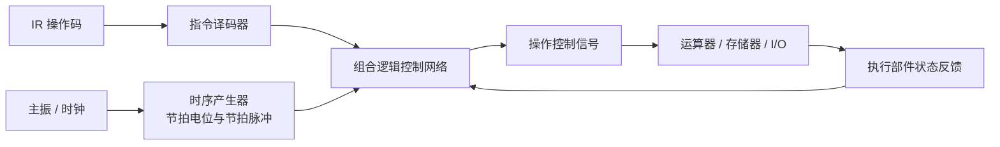

# 硬布线控制器

> 根据《计组_中央处理器-2.pdf》整理。本文中的指令名、节拍电位及控制信号表达式来自课件的简化模型；不要直接套用于其他处理器。

## 1. 基本思想

**硬布线控制器**（又称组合逻辑控制器）用逻辑电路产生控制信号。其控制逻辑的输入通常有三类：

1. 指令操作码译码输出 `Im`；
2. 执行部件返回的状态/反馈信息 `Bj`；
3. 时序产生器给出的节拍电位 `Mi`、节拍脉冲 `Tk` 等。

可概括为：

`控制信号 C = f(指令译码、状态反馈、时序信号)`

课件结构示意：

## 2. 特点与适用场景

**优点**

- 控制信号由组合逻辑直接产生，不需要逐条从控制存储器读取微指令，通常速度较快。
- 课件将硬布线控制器列为 RISC 及高性能计算机常见方案之一。

**缺点**

- 指令、时序和状态组合增多时，逻辑设计与验证较复杂。
- 修改指令功能或扩展控制逻辑比较困难，往往需要重新设计电路。

## 3. 时序信号与指令流程

硬布线控制器的时序产生器除节拍脉冲外，通常还产生**节拍电位**。节拍电位将一条指令的微操作划分到不同时间区间，节拍脉冲可进一步确定控制信号的有效时刻。

课件示例用 `M1、M2、M3` 表示不同机器周期/节拍电位，用 `T1–T4` 表示一个 CPU 周期内的节拍脉冲。具体命名是课程模型约定。

设计信号时要区分：

- **电位信号**：在某一阶段持续有效，例：课件中 `RD(I)=M1`。
- **脉冲信号**：只在相应节拍上有效，例：课件中 `WE(D)=M3·T3·STO`。
- **存储器读写控制**：读/写命令通常需要与地址、数据建立时序配合；只写控制表达式还应检查读写信号在哪个节拍有效。

## 4. 设计流程

1. **分析指令**：列出指令系统中每条指令的功能和操作流程。
2. **划分时序**：将各微操作放入机器周期、节拍电位和节拍脉冲中；访存操作通常比内部传送需要更细致的时序。
3. **归并同名微操作**：找出产生同一控制信号的所有指令和时序条件。
4. **写布尔表达式**：将“指令译码 × 时序 × 状态条件”组合成控制函数，并按布尔代数化简。
5. **实现并验证**：用门电路或可编程逻辑实现，检查并行冲突、信号有效时刻和异常路径。

## 5. 例：五指令教学模型的控制函数

该例的指令为 `MOV、LAD、ADD、STO、JMP`。设相应操作码译码结果仍用指令名表示，`M1–M3` 为节拍电位，`T1–T4` 为节拍脉冲。并列相乘表示逻辑与 `·`，`+` 表示逻辑或。

| 控制信号 | 控制功能 | 逻辑表达式 |
|---|---|---|
| `RD(I)` | 指令存储器读 | `M1`（电位信号） |
| `RD(D)` | 数据存储器读 | `M3 · LAD`（电位信号） |
| `WE(D)` | 数据存储器写 | `M3 · T3 · STO`（脉冲信号） |
| `LDPC` | 装入 PC | `M1 · T4 + M2 · T4 · JMP` |
| `LDIR` | 装入 IR | `M1 · T3` |
| `LDAR` | 装入地址寄存器 | `M2 · T4 · (LAD + STO)` |
| `LDDR` | 装入数据缓冲寄存器 | `M2 · T3 · (MOV + ADD) + M3 · T3 · LAD` |
| `PC+1` | PC 自增 | `M1 · T4` |
| `LDR2` | 装入 R2 | `M2 · T4 · ADD` |

### 读表达式的检查方法

以 `LDAR` 为例：地址寄存器在 `LAD` 或 `STO` 的执行步骤装入，所以控制条件为：

`LDAR = 执行阶段(M2) · T4 · (LAD 或 STO)`

以 `WE(D)` 为例：只有存数指令需要写数据存储器，且写操作发生在指定节拍，因此表达式同时包含 `M3`、`T3`、`STO`。

## 6. 例：小型累加器模型控制器

另一组课件例题使用 `CLA、ADD、STA、JMP、NOP` 五条指令：

| 指令 | 功能 |
|---|---|
| `CLA` | `0 → AC` |
| `ADD AC, M` | `(AC) + M[地址] → AC` |
| `STA M` | `(AC) → M[地址]` |
| `JMP m` | `m → PC` |
| `NOP` | 空操作/延时 |

该例先列微操作，再按节拍分配，最后给每个微操作命名 `C0–C11`：

| 信号 | 微操作 | 逻辑表达式 |
|---|---|---|
| `C0` | `PC → AR → ABUS` | `M1 · T1` |
| `C1` | `PC+1 → PC` | `M1 · T4` |
| `C2` | `IR → PC` | `M2 · T1 · JMP` |
| `C3` | `IR → AR → ABUS` | `M2 · T1 · (ADD + STA)` |
| `C4` | `DR → IR` | `M1 · T4` |
| `C5` | `DR → ALU` | `M3 · T3 · ADD` |
| `C6` | `DR → DBUS` | `M3 · (T2 + T3) · STA` |
| `C7` | `DBUS → DR` | `M1 · (T2 + T3) + M3 · (T1 + T2) · ADD` |
| `C8` | `AC → DR` | `M3 · T1 · STA` |
| `C9` | `AC → ALU` | `M3 · T3 · ADD` |
| `C10` | `ALU → AC` | `M3 · T3 · ADD` |
| `C11` | `0 → AC` | `M2 · T1 · CLA` |

> 注意：此表将 `C7` 的多个阶段合并在一个表达式中。遇到题目时，应先以题给数据通路和时序图为准，再列出每一项，不能只凭指令名字猜表达式。

## 7. 硬布线与微程序控制比较

| 项目 | 硬布线控制 | 微程序控制 |
|---|---|---|
| 控制信号来源 | 组合逻辑函数 | 微指令控制字段 |
| 速度 | 通常较快，受逻辑电路延迟影响 | 需读取控制存储器中的微指令，通常较慢 |
| 修改/扩展 | 困难 | 较灵活，修改微程序较方便 |
| 设计结构 | 指令和时序逻辑关系复杂时难维护 | 结构规整，适合用微指令序列表达控制 |
| 常见倾向 | 简单、追求速度的控制逻辑 | 指令控制较复杂、需要可维护性的设计 |

考试记忆：**硬布线 = 快、修改难；微程序 = 灵活、易维护，但取微指令有开销。**这是总体倾向，不代表每一种具体实现绝对如此。

## 8. 易错点

- 控制信号表达式需同时考虑**操作码、时序、状态反馈**，不是只写操作码。
- `+` 常表示逻辑或；乘积项表示逻辑与，括号用于组合多个指令条件。
- 访存控制要分清**指令读** `RD(I)`、**数据读** `RD(D)`、**数据写** `WE(D)`。
- 写回/装入控制信号必须出现在正确节拍；表达式逻辑上正确但时序错，仍会导致错误数据通路。
- 同一控制信号可由多个指令/阶段产生，最终表达式是所有有效条件的或。

## 参考

- `___TempFiles/计组_中央处理器-2.pdf`，第 5.5 节“硬连线控制器”及设计举例。
